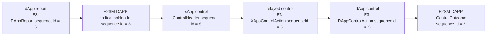
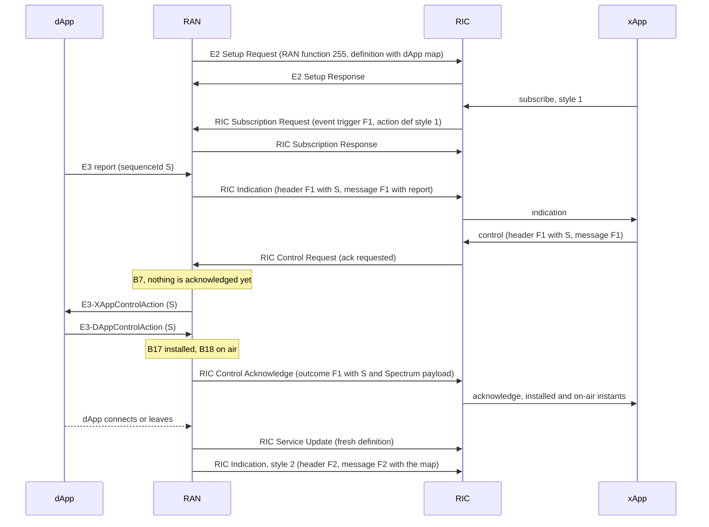

# E2SM-DAPP: procedure flow

This chapter describes how an xApp learns which dApps exist, subscribes, receives
reports, sends a control and gets the acknowledge. It places every E2SM-DAPP message
on the E2AP message that carries it.

The index is [README.md](../e2sm-dapp/README.md). The field lists are in
[02-ie-mapping.md](02-ie-mapping.md). The E2-E3 loop and its box numbers
(`A1` to `A20`, `B1` to `B19`) are defined in
[../control-loops/path-a-e3-loop.md](../control-loops/path-a-e3-loop.md) and
[../control-loops/path-b-e2-e3-loop.md](../control-loops/path-b-e2-e3-loop.md).
Code references for each step are in [integrator-guide.md](integrator-guide.md).

## Roles

Table: Roles in the E2SM-DAPP flow

| Role | Description | Speaks |
|---|---|---|
| **dApp** | An application next to the RAN, for example a spectrum dApp | E3AP to the RAN |
| **RAN** | A gNB. It hosts the E3 agent, the E2 agent and the **E2-E3 bridge** (the "dApp RAN function") between them | E3AP to dApps, E2AP to the RIC |
| **RIC** | The near-RT RIC | E2AP to the RAN, and an internal interface to xApps |
| **xApp** | An application on the RIC, for example a decision engine | E2SM-DAPP, wrapped in E2AP by the RIC |

The E2 RAN function id of E2SM-DAPP is **255**. All E2SM-DAPP traffic is RIC
Subscription, RIC Indication, RIC Control and the RAN function advertisement.
No dApp-to-RIC path bypasses the RAN.

## Messages on the flow

Table: E2AP messages that carry E2SM-DAPP content

| # | Direction | E2AP message | E2SM-DAPP content | Described in |
|---|---|---|---|---|
| S1 | RAN to RIC | E2 Setup Request | RAN function item for id 255: definition, revision 1, OID | Discovery |
| S2 | RIC to RAN | E2 Setup Response | none (E2AP only) | |
| S3 | RAN to RIC | RIC Service Update | RAN function id 255 in "modified", with a fresh definition | Discovery |
| S4 | RIC to RAN | RIC Service Acknowledge | none (E2AP only) | |
| P1 | RIC to RAN | RIC Subscription Request | event trigger (format 1), one report action with an action definition (style 1 or 2) | Subscription |
| P2 | RAN to RIC | RIC Subscription Response | none (E2AP only), the single action is admitted | Subscription |
| P3 | RIC to RAN | RIC Subscription Delete Request | none | Subscription |
| P4 | RAN to RIC | RIC Subscription Delete Response | none | Subscription |
| R1 | RAN to RIC | RIC Indication (report) | style 1: indication header format 1 and message format 1 (one dApp report) | Indication delivery |
| R2 | RAN to RIC | RIC Indication (report) | style 2: indication header format 2 and message format 2 (the dApp subscription map) | Discovery, Indication delivery |
| C1 | RIC to RAN | RIC Control Request | control header format 1, control message format 1, with "ack" requested | Control relay |
| C2 | RAN to RIC | RIC Control Acknowledge | control outcome format 1 (timestamp, sequence id, optional Service-Model payload). **Sent late**, see the deferred acknowledge | Control relay |

The RAN shall not send a RIC Control Failure for E2SM-DAPP. Every control ends in
a RIC Control Acknowledge, even a control that the RAN refused or that timed out.

E2SM-DAPP uses no other E2AP procedure. In particular it has no RIC Query, no
insert and no policy. The reasons are in [02-ie-mapping.md](02-ie-mapping.md).

## Discovery: how an xApp learns the dApp ids

An xApp needs a `dapp-id` and an E3 RAN function id for the control header. Both
come from the **dApp E3 subscription map**. The map lists the dApps connected to
the RAN, each with the E3 RAN functions it has subscribed to. The map reaches the
xApp in three ways.

### In the RAN function definition

The map is the optional `dappE3Subscriptions` field of the report item (style 1) and
of the control item (style 1) in the RAN function definition. The field list is in
[02-ie-mapping.md](02-ie-mapping.md).

Table: How the definition reaches the xApp

| Step | E2AP message | What happens |
|---|---|---|
| RAN builds the definition | inside S1 or S3 | The E2 agent asks the RAN for the definition. The agent replaces the name, the OID and the description with the constants of E2SM-DAPP. Then it encodes the definition. |
| RAN fills styles and map | | The RAN offers two report styles and one control style. It offers no event trigger. It copies the map into report style 1 and into control style 1. |
| E2 Setup | S1 | The definition goes in the RAN function item. |
| RIC stores it | | The RIC keeps the definition in the node information that it exposes to xApps. |
| xApp decodes it | | The xApp finds RAN function 255 in the node information and decodes the definition. |

Procedure:

* The RAN shall build the definition again on every E2 Setup Request, including a
  retried request. A retried request therefore carries the map as it is at that
  moment.
* The map shall hold one item for every dApp that has at least one subscribed E3
  RAN function.
* If no dApp has a subscribed function, the RAN shall omit `dappE3Subscriptions`.
  The RAN shall not send an empty list in the definition, because some encoders
  cannot encode it. See [06-discrepancies.md](06-discrepancies.md).
* An xApp shall treat an absent field and an empty list in the same way: no dApp is
  connected.

### When the set of dApps changes

When a dApp connects or disconnects, the RAN does two things on the thread of the E3
agent.

1. **RIC Service Update (S3).** The RAN rebuilds the definition. It sends the
   definition as RAN function 255 under "modified". It adds no function and deletes
   no function. The RAN shall not send this message before the RIC has been heard
   from, because the send blocks the E3 thread while the SCTP association is still
   being set up.
2. **Format 2 indication (R2).** For every style-2 subscription, the RAN sends a RIC
   Indication with header format 2 and message format 2. The message holds the
   **current** map. The list holds every dApp that has at least one function. The
   list can be **empty**: all dApps left.

The revision in the RIC Service Update starts at `1` and increases by one per
update. The E2 Setup Request already announced revision `1`, so the first update
repeats it. See [01-identity-and-registration.md](01-identity-and-registration.md).

### In every report header

Each style-1 indication names the `dapp-id` that sent the report (indication header
format 1). An xApp that only answers reports does not need the map. It shall echo
the `dapp-id` and the `ran-function-id` of the header that it just received. A
decision engine that stores the `dapp-id` with each detection and puts it in the
control follows this method.

### What discovery does not do

* **Subscribing to style 2 does not return the current map.** The RAN only records
  the RIC request id. The first format 2 indication arrives at the next dApp connect
  or disconnect. To learn the current map, an xApp reads it from the definition, or
  subscribes before the dApps start.
* **No initial indication exists** for style 1. Reports flow when dApps send them.
* **A cached definition goes stale.** An xApp that caches the decoded definition does
  not see a later RIC Service Update. This does not matter for an xApp that takes
  the `dapp-id` from the reports.

## Subscription: pairing the xApp with the report stream

E2SM-DAPP has no per-dApp subscription. A subscription picks a **report style** and
receives that style's indications from **every** dApp.

Table: Subscription steps

| Step | E2AP message | E2SM-DAPP content |
|---|---|---|
| xApp builds the request | P1 | Event trigger: format 1 (empty). One action: type `report`, id 1, action definition `style = 1` or `2`. |
| RAN decodes it | | Event trigger and action definition. |
| RAN registers the subscriber | | Style 1 adds the RIC request id to the format-1 subscriber list. Style 2 adds it to the format-2 list. |
| Admission | P2 | The RAN always admits the single action. |
| Teardown | P3, P4 | The RAN removes the subscriber. |

Procedure:

* A RIC Subscription Request for E2SM-DAPP shall hold exactly one action, and the
  action shall be a report action.
* The RAN shall treat a second request under the same RIC request id as a
  replacement of the first.
* The subscription is **aperiodic**. It has no reporting period.
* The RAN shall admit the single action when the action definition has style 1 or 2.

**Pairing with a dApp happens at control time, not at subscription time.** The xApp
chooses a `(dapp-id, ran-function-id)` pair from what it learned during discovery
and puts it in the control header. The RAN does not check that the dApp exists or
has subscribed to that function before it relays the control. The RAN only learns
whether its E3 library accepted the call.

## Indication delivery (report up)

This is the report-up leg of
[Path B](../control-loops/path-b-e2-e3-loop.md#report-up-leg-legreport_up), boxes
`B1` to `B4`, entered from `A20`.

Table: Report-up boxes

| Box | What happens | E2AP / E2SM-DAPP |
|---|---|---|
| `A20` | The E3 report arrives from the dApp and goes to the bridge | E3AP `E3-DAppReport` with `dAppIdentifier`, `ranFunctionIdentifier`, `sequenceId`, `reportData` |
| `B1` build | The bridge makes one indication per **style-1** subscriber. The header is format 1 (`ran-function-id`, `dapp-id`, node identity, `timestamp`, `sequence-id`). The message is format 1 (`data` = the unchanged `reportData`). | R1: RIC Indication, type report |
| `B1` encode | The E2 agent encodes header and message. It **drops** a header or message that the encoder declines. It does not abort. | |
| `B1` send | RIC Indication, action id from the subscription, no sequence number, no call process ID | |
| `B2` | E2AP decode at the RIC | |
| `B3` decode | The RIC side decodes header and message. For format 1 it can also decode the inner payload, using `ran-function-id` as the key. | |
| `B4` | The xApp processes the report | |

Procedure:

* The bridge shall send every report to every style-1 subscriber. It shall not filter
  by dApp or by function.
* The bridge shall copy the unchanged `reportData` into `data`, and the
  `sequenceId` of the report into `sequence-id`.
* A style-2 indication follows the same path with R2 and a different trigger (see
  Discovery). It has no `A20`: the RAN generates it from the E3 subscription map.
* A RIC side that cannot decode the inner payload of a format 1 message, or that
  meets an unknown format, can fail. See [06-discrepancies.md](06-discrepancies.md).

## Control relay and the deferred acknowledge

This covers boxes `B5` to `B19`.

### Policy down: from the xApp to the dApp

Table: Policy-down boxes

| Box | What happens | E2AP / E2SM-DAPP |
|---|---|---|
| `B4` to `B5` | The xApp decides. It builds the control header (`ran-function-id`, `dapp-id`, `timestamp`, `sequence-id` **echoed from the report**) and the control message (`data` = the Service-Model control payload). | |
| `B6` | E2AP framing | C1: RIC Control Request, **ack requested** |
| `B7` | The E2 agent of the RAN decodes the request. | |
| `B8` | E2SM decode of the control header and message | |
| `B9` | The bridge relays the control over E3. | |
| `B10`, `B11` | E3AP `E3-XAppControlAction` with `dAppIdentifier`, `ranFunctionIdentifier`, `sequenceId` (copied from the control header), `xAppControlData` (the control message `data`) | |
| `B12` to `B15` | The dApp receives, decodes and applies the policy | |

Procedure:

* The xApp shall request an acknowledge in the RIC Control Request. The E2 agent
  can abort on a request without it.
* The xApp shall echo the `sequence-id` of the report in the control header.
* The bridge shall copy the `sequence-id` of the control header into the
  `sequenceId` of `E3-XAppControlAction`.
* If the `sequence-id` is absent or `0`, the RAN shall acknowledge at once and shall
  not apply the control. The control cannot be matched to a procedure.
* If the table of pending controls is full, or the E3 send fails, the RAN shall
  acknowledge at once and shall not apply the control.

### Mitigation: from the dApp back to the air

Table: Mitigation boxes

| Box | What happens |
|---|---|
| `B16` | The dApp re-issues the policy as an E3 control. It carries the same `sequenceId`. |
| `A12` to `A18` | E3AP `E3-DAppControlAction` travels from the dApp to the RAN. |
| `B17` apply | The Spectrum service model of the RAN writes the mask into the MAC. It records the instant on the **realtime** clock, per `sequenceId`. |
| `B18` live on air | The first scheduler tick that uses the mask records the instant, again on the realtime clock, with the frame and the slot. |
| A mask replaced before any tick ran | The RAN retires the control as *superseded*. The control is installed and has no on-air instant. |

### The E2 acknowledge is deferred to B19

**The RAN shall send the RIC Control Acknowledge when the mitigation lands (B19).**
It shall not send it when it receives the request (B7). An acknowledge sent at `B7`
would say only that the request was forwarded. It would leave before the dApp has
seen the control and long before any mask exists. A reader could not take it as
completion.

Table: Steps of the deferred acknowledge

| Step | What happens |
|---|---|
| 1 | The E2 agent calls the RAN function handler. When the handler answers "no outcome yet", the agent returns a **deferred** result. It keys the result by the `sequence-id` of the control header. |
| 2 | The E2 agent parks the RIC request id under that key and sends **no E2 message**. If the table of parked controls is full (64 entries), it acknowledges at once. |
| 3 | The RAN function opened a pending control for the id before it forwarded the control. |
| 4 | When the mask is on the air (B18), the RAN builds the outcome and completes the parked control. |
| 5 | The E2 agent claims the parked RIC request id. It sends **C2, a RIC Control Acknowledge**, with the E2SM-DAPP control outcome in its control-outcome field. |
| 6 | The xApp receives C2 and reads `sequence-id` and the payload. |

The outcome carries the **two instants B17 and B18** inside the Spectrum payload
(`installedTimestamp`, `onAirTimestamp`) and the `sequence-id` of the procedure. The
field list is in [02-ie-mapping.md](02-ie-mapping.md).

**Timeouts.** A dApp that never answers shall not hold an xApp forever.

Table: Pending-control timeouts

| Timer | Value | Effect |
|---|---|---|
| RAN pending-control timeout | 150 ms | The RAN retires the control as failed. It still sends a RIC Control Acknowledge. The outcome holds the install instant only if the install happened, and holds no on-air instant. |
| E2 agent pending-control timeout | 200 ms | The timer would send an acknowledge without an outcome. The reference E2 agent never starts the sweep that runs it, so only the RAN timer is in effect. |

The RAN timer shall stay shorter than the E2 agent timer. The RAN then gives up
first, and the acknowledge still carries information.

### The mitigation figure

The xApp computes detection-to-mitigation from numbers that all come from the RAN
side clock, `CLOCK_REALTIME` at the gNB:

```text
origin_ts_ns   dApp report timestamp, inside the report payload (Spectrum-DAppReportData.timestamp)
installed_ts_ns   B17, inside the control outcome payload
on_air_ts_ns      B18, inside the control outcome payload

mitigation_latency_ns = on_air_ts_ns   - origin_ts_ns
install_latency_ns    = installed_ts_ns - origin_ts_ns
```

The xApp adds no clock of its own to these two values. It moves the numbers and
subtracts them. The fields `control_sent_ts_ns` and `de_read_ts_ns` in the same
record use the xApp's own clock, and the xApp uses them only against each other.
See [05-semantics-and-constraints.md](05-semantics-and-constraints.md) for why the
dApp, gNB and payload stamps can be subtracted and the latency recorder's stamps
cannot.

## The loop on the boxes

This section shows the same boxes as
[Path B](../control-loops/path-b-e2-e3-loop.md#box-order), with each E2SM-DAPP
message on the box that produces or consumes it. Solid boxes are in the E2-E3 loop.
The three E2SM-DAPP-only boxes on the right are discovery and teardown, outside the
loop.

```mermaid
flowchart LR
    subgraph DAPP1["dApp"]
        D0["dApp report<br/>sequenceId = S"]
    end

    subgraph RAN1["RAN"]
        A20["A20 E2-E3 bridge"]
        B1["B1 E2 indication encode<br/>IndicationHeader F1 (seq-id = S)<br/>IndicationMessage F1 (data)"]
    end

    subgraph RIC["RIC and xApp"]
        B2["B2 E2AP decode"]
        B3["B3 E2SM decode"]
        B4["B4 xApp decision"]
        B5["B5 E2SM encode<br/>ControlHeader F1 (seq-id = S)<br/>ControlMessage F1 (data)"]
        B6["B6 E2AP encode<br/>RIC Control Request, ack requested"]
        B2 --> B3 --> B4 --> B5 --> B6
    end

    subgraph RAN2["RAN"]
        B7["B7 E2AP decode<br/>(no acknowledge sent here)"]
        B8["B8 E2SM decode"]
        B9["B9 E2-E3 bridge<br/>E3-XAppControlAction (seq-id = S)"]
        B7 --> B8 --> B9
    end

    subgraph DAPP2["dApp"]
        B15["B12-B15 apply policy"]
        B16["B16 re-issue control<br/>E3-DAppControlAction (seq-id = S)"]
        B15 --> B16
    end

    subgraph RAN3["RAN"]
        B17["B17 apply control<br/>installed_ts"]
        B18["B18 live on air<br/>on_air_ts, sfn, slot"]
        B19["B19 deferred RIC Control Acknowledge<br/>ControlOutcome F1<br/>(seq-id = S, e3-control-outcome)"]
        B17 --> B18 --> B19
    end

    D0 -.->|E3 wire| A20
    A20 --> B1
    B1 -.->|E2 wire| B2
    B6 -.->|E2 wire| B7
    B9 -.->|E3 wire| B15
    B16 -.->|E3 wire| B17
    B19 -.->|E2 wire| B4
```



The last edge goes back to the xApp. The acknowledge arrives at the same process that
decided (`B4`) and closes the procedure.

### The sequence-id chain

One identifier joins every hop. It starts at the dApp. No component reassigns it.



Table: Where the sequence-id is assigned or copied

| Hop | Field | Assigned or copied by |
|---|---|---|
| dApp report | `E3-DAppReport.sequenceId`, mandatory, `E3-SequenceID (1..4294967295)` | assigned by the dApp, per detection |
| indication | `IndicationHeader-Format1.sequence-id` | copied by the RAN bridge |
| xApp control | `ControlHeader-Format1.sequence-id` | echoed by the xApp |
| relayed control | `E3-XAppControlAction.sequenceId`, mandatory | copied by the RAN bridge |
| dApp re-issue | `E3-DAppControlAction.sequenceId`, optional | carried back by the dApp; absent on a control the dApp decided on its own |
| outcome | `ControlOutcome-Format1.sequence-id` | set by the RAN; also the key under which the E2 agent parked the request |

The two E3 messages in the middle use an id of `1..4294967295`. The
`SequenceId` of E2SM-DAPP is an unbounded `INTEGER`. A value of `0` or an absent
field means "no procedure". The RAN cannot match such a control, and it
acknowledges the control at once without applying it.

### The same flow as a sequence



## Differences between implementations

Implementations share the E2SM-DAPP messages and differ in what they do around them.
Two kinds exist. Implementation A has both the E2 side and the E3 side in the RAN.
Implementation B has the E2 side only, and it reaches the E3 side through two
interfaces: a source of indications and a sink for controls. The code references and
the product names are in [integrator-guide.md](integrator-guide.md) and
[06-discrepancies.md](06-discrepancies.md).

Table: Behavior of implementation B

| Step | Behavior |
|---|---|
| Without an E3 side | No-op implementations advertise the RAN function and admit subscriptions. They never report. They refuse every control with the E2AP cause "system not ready". |
| Definition | The definition is fixed. It holds the name block, an event trigger section, two report styles (`E3 Data Report` with formats 1 and 1, `E3 Subscription Map` with formats 2 and 2) and one control style (`dApp Control`, formats 1, 1, 1). It never holds `dappE3Subscriptions`, because the map is dynamic. Implementation B sends no RIC Service Update for E2SM-DAPP. The RAN function revision in its E2 Setup Request is `0`, although the packer holds `1`. |
| Subscribe | The RAN admits a report action whose action definition has style 1 or 2. It refuses everything else. The E2 agent then reports "not admitted" and does not abort. The event trigger gives a fixed **10 ms poll period**, because the E2 agent only runs periodic indications. The RAN sends at most one indication per poll and subscription. |
| Indicate | The RAN asks the source for the next indication of the subscription. It drops an indication whose formats do not match the style. It drops a style-1 indication whose `data_size` differs from the octet count of `data`. It drops an indication whose header and message exceed 16319 octets together. |
| Control | The RAN rejects a control whose `data-size` differs from the octet count of `data`, with the cause "control message invalid". Otherwise it hands the control to the sink and **waits for the sink's task**. The RIC Control Acknowledge, or the RIC Control Failure with the cause of the sink, goes out after that. The acknowledge is deferred in the same sense as in implementation A. A control without "ack requested" is applied and not answered. |
| Outcome | The RAN always echoes the `timestamp` and the `sequence-id` of the **control header** into the outcome. It adds the outcome payload of the sink when it fits within 16287 octets. Unlike implementation A, it does not stamp the build time of the outcome, and it also sends the outcome on a failure. |

Two more differences matter to a RIC-side implementer.

* **Two halves.** In implementation A, one library holds the RAN-side half and the
  RIC-side half of the E2SM. A RIC that has its own E2AP stack can use the library
  for E2SM encode and decode only, and then never runs the RIC-side half.
* **The RIC-side control path.** The RIC-side half of implementation A encodes the
  inner Service-Model payload itself, for the Spectrum service model only. An xApp
  framework that encodes the payload before it calls the E2SM encoder does not
  depend on this. The RIC-side half returns an all-zero request, silently, when the
  control type is none or when the control message already holds data.
