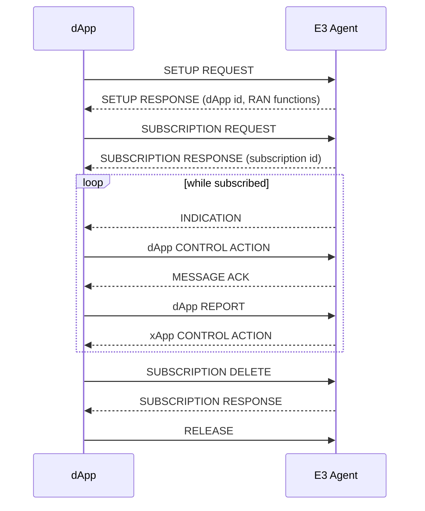

# E3AP: procedure flow

The procedures of E3AP, in the order a dApp uses them: Setup, Subscription,
Indication, Control, Report and Release. Each procedure has a purpose, the steps of
each side, the successful operation, the unsuccessful operation and the abnormal
conditions.

This is clause 7 of the specification. The index is [README.md](../e3ap/README.md). The
messages are in [02-ie-mapping.md](02-ie-mapping.md). The rules for ranges, clocks
and errors are in [05-semantics-and-constraints.md](05-semantics-and-constraints.md).

## Roles

Table: Roles in the procedures

| Role | Who | What it does |
|---|---|---|
| dApp | an application next to the RAN | starts Setup, Subscription, dApp Control, dApp Report and Release. Receives Indication, xApp Control and Release. |
| E3 Agent | the E3 entity in the RAN node | answers Setup and Subscription. Sends Indication, xApp Control and Acknowledgement. Hosts the RAN functions. |
| Service model | the definition of one RAN function | gives meaning to the payloads. Starts and stops with the first and the last subscriber. |
| RIC side | an xApp and the E2 interface | sends xApp Control through the E3 Agent. Receives dApp Report through the E3 Agent. See [E2SM-DAPP](../e2sm-dapp/README.md). |

## Messages on the flow

Table: Which message starts which procedure

| Procedure | Request | Response or result | Channel of the request |
|---|---|---|---|
| Setup | SETUP REQUEST | SETUP RESPONSE | setup |
| Subscription | SUBSCRIPTION REQUEST | SUBSCRIPTION RESPONSE | inbound to the E3 Agent |
| Subscription delete | SUBSCRIPTION DELETE | SUBSCRIPTION RESPONSE | inbound to the E3 Agent |
| Indication | INDICATION | none | outbound from the E3 Agent |
| dApp Control | dApp CONTROL ACTION | MESSAGE ACK, if the service model sends one | inbound to the E3 Agent |
| dApp Report | dApp REPORT | none | inbound to the E3 Agent |
| xApp Control | xApp CONTROL ACTION | none | outbound from the E3 Agent |
| Release | RELEASE | none | either direction |

## Setup

### Purpose

The Setup procedure registers a dApp with an E3 Agent. It gives the dApp an
identifier and tells it which RAN functions exist.

### Procedure

1. The dApp sends a SETUP REQUEST message on the setup channel. The message holds the protocol version, the name of the dApp, the version of the dApp and the vendor.
2. The E3 Agent decodes the message and assigns the lowest free dApp identifier.
3. The E3 Agent builds the RAN function list from its service models. It leaves out a RAN function that does not fit the limits in [01-identity-and-registration.md](01-identity-and-registration.md#what-the-ran-function-list-holds).
4. The E3 Agent sends a SETUP RESPONSE message. It sets `requestId` to the message identifier of the request.

### Successful operation

The SETUP RESPONSE message has `responseCode` "positive". It holds `dAppIdentifier`,
`ranIdentifier`, `e3apProtocolVersion` and `ranFunctionList`. The dApp keeps the
dApp identifier and the RAN function list. The dApp may subscribe from now.

### Unsuccessful operation

The E3 Agent shall answer with `responseCode` "negative" when it cannot register the
dApp, for example when it has no free dApp identifier. A negative response has no
`dAppIdentifier`. The E3 Agent shall also answer with a negative response when the
message does not decode or is not a SETUP REQUEST message. The response then has no
`ranFunctionList`.

A dApp that receives a negative response has no session. It shall not send other
messages.

### Abnormal conditions

* The dApp gets no response. It shall send the request again. The E3 Agent has no memory of the first attempt, so each attempt that reaches it registers a new dApp. A late response to an earlier attempt leaves one identifier registered with no owner. The E3 Agent frees it only when a RELEASE message names it.
* The E3 Agent receives a version string that it does not support. It may answer with "negative". An implementation that does not check the version answers "positive".
* The message identifier of the request is 0. The E3 Agent shall put a new message identifier in `requestId`, because 0 is not a valid value.

## Subscription

### Purpose

The Subscription procedure tells the E3 Agent that a dApp uses a RAN function. It
starts the service model of the RAN function if the dApp is its first subscriber.

### Procedure

1. The dApp sends a SUBSCRIPTION REQUEST message on the inbound channel. It names the RAN function and lists the telemetry identifiers and the control identifiers that it wants. It may add a time limit and an interval.
2. The E3 Agent checks that the dApp is registered.
3. The E3 Agent adds the subscription. The key of a subscription is the pair of dApp and RAN function. It assigns the lowest free subscription identifier.
4. If this is the first subscriber of the RAN function, the E3 Agent starts the service model.
5. The E3 Agent sends a SUBSCRIPTION RESPONSE message.

### Successful operation

The SUBSCRIPTION RESPONSE message has `responseCode` "positive" and holds
`subscriptionId`. It also lists the telemetry identifiers and control identifiers that
the E3 Agent grants, the RAN function identifier and the interval that it grants.
The dApp keeps the subscription identifier. A grant list that is missing means that
the E3 Agent does not report the grant. A grant list that is empty means that it
grants nothing.

A second SUBSCRIPTION REQUEST message for the same RAN function from the same dApp
returns the existing subscription identifier and "positive". It does not create a
second subscription.

The E3 Agent sends the interval in microseconds. The value 0 means one indication for
each event. A missing interval means that the service model sets the rate.

### Unsuccessful operation

The E3 Agent shall answer "negative" when the dApp is not registered or when it has no
free subscription identifier. The E3 Agent should answer "negative" when the RAN
function identifier is not in its list, and when an identifier is not offered by
the RAN function. Some implementations do not make these two checks. They answer
"positive" and grant what the dApp asked for. See [06-discrepancies.md](06-discrepancies.md).

### Abnormal conditions

* The time limit ends. The E3 Agent removes the subscription and sends nothing. It stops the service model if the subscription was the last one. A time of 0 or a missing time means no limit.
* The dApp sends the same request again after the time limit has ended and before the E3 Agent removes the subscription. The E3 Agent renews the subscription under the same identifier.
* The service model fails to start. The E3 Agent still answers "positive". The dApp receives no indication.

## Subscription delete

### Purpose

The Subscription delete procedure ends one subscription.

### Procedure

1. The dApp sends a SUBSCRIPTION DELETE message with the subscription identifier.
2. The E3 Agent removes the subscription.
3. If the subscription was the last one for the RAN function, the E3 Agent stops the service model.
4. The E3 Agent sends a SUBSCRIPTION RESPONSE message.

### Successful operation

The response has `responseCode` "positive" and `subscriptionId`. The subscription
identifier is free again.

### Unsuccessful operation

The response has `responseCode` "negative" when the subscription identifier is
unknown, belongs to another dApp, or has already ended.

### Abnormal conditions

* A subscription that has passed its time limit can still be deleted with "positive" until the E3 Agent removes it. The E3 Agent checks for such subscriptions every 250 ms.

## Indication

### Purpose

The Indication procedure delivers telemetry from a RAN function to a dApp.

### Procedure

1. The service model produces a payload.
2. The E3 Agent puts the payload in `protocolData` of an INDICATION message. It names the dApp and the RAN function.
3. The E3 Agent sends the message on the outbound channel.
4. The dApp reads `dAppIdentifier`. If the identifier is not its own, the dApp ignores the message. Otherwise it gives the payload to its handler.

### Successful operation

The dApp handler receives the payload. There is no response.

### Unsuccessful operation

There is no response. If the outbound queue of the E3 Agent is full, the E3 Agent
drops the message.

### Abnormal conditions

* On a link that broadcasts, every dApp receives every INDICATION message. The check of `dAppIdentifier` is the only filter.
* The E3 Agent may send an INDICATION message to a dApp that did not subscribe. A dApp should ignore an indication for a RAN function that it did not subscribe to.

## dApp Control

### Purpose

The dApp Control procedure lets a dApp ask a RAN function to do something.

### Procedure

1. The dApp sends a dApp CONTROL ACTION message on the inbound channel. It names the RAN function and the control identifier. It carries the payload in `actionData`.
2. If the dApp acts on an xApp CONTROL ACTION message, it puts that message's `sequenceId` in the new message. If the dApp decided on its own, it leaves `sequenceId` out.
3. The E3 Agent finds the service model of the RAN function. If the service model runs, the E3 Agent gives it the payload and the message identifier.
4. The service model applies the action. It may send a MESSAGE ACK message.

### Successful operation

The service model applies the action. If it sends a MESSAGE ACK message, `requestId`
holds the message identifier of the dApp CONTROL ACTION message and `responseCode`
holds the result.

### Unsuccessful operation

The service model may send a MESSAGE ACK message with `responseCode` "negative".

### Abnormal conditions

* The RAN function is not known, or its service model does not run. The E3 Agent drops the message. It sends no response.
* The E3 Agent does not check the control identifier or the dApp identifier. The service model does.
* A MESSAGE ACK message has no dApp identifier. On a link that broadcasts, every dApp receives it. A dApp shall ignore a MESSAGE ACK message whose `requestId` is not the identifier of a message that it sent.

## dApp Report

### Purpose

The dApp Report procedure sends a result from a dApp to a RIC. It is the start of an
E2-E3 loop.

### Procedure

1. The dApp assigns a sequence identifier. The identifier is the key of the whole procedure.
2. The dApp sends a dApp REPORT message with `sequenceId` and the payload in `reportData`.
3. The E3 Agent puts the message in a queue. A worker takes it from the queue and gives it to the RIC side. The E3 Agent does not read `reportData`.
4. The RIC side copies `sequenceId` into the E2SM-DAPP indication header. See [E2SM-DAPP](../e2sm-dapp/03-procedure-flow.md).

### Successful operation

There is no response. The report is delivered when the RIC side receives it.

### Unsuccessful operation

A dApp shall not send a dApp REPORT message with `sequenceId` 0. The value is not
valid on any encoding.

### Abnormal conditions

* The report queue of the E3 Agent is full. The E3 Agent drops the message and logs it.
* No handler is set on the E3 Agent. It drops the message.
* The E3 Agent does not check the dApp identifier, the RAN function identifier or the sequence identifier of a report.

## xApp Control

### Purpose

The xApp Control procedure hands a decision of an xApp to a dApp.

### Procedure

1. The RIC side receives a decision for a dApp. Its E2SM-DAPP control header holds a sequence identifier.
2. The E3 Agent sends an xApp CONTROL ACTION message with that sequence identifier unchanged and the payload in `xAppControlData`.
3. The dApp ignores the message if the dApp identifier is not its own.
4. The dApp gives the payload to its handler. It may act on it. If it re-issues the action to the RAN, it follows the dApp Control procedure with the same sequence identifier.

### Successful operation

The dApp handler receives the payload. There is no response in E3AP. The RIC side
learns the result from the control outcome of E2SM-DAPP.

### Unsuccessful operation

An E3 Agent shall not send an xApp CONTROL ACTION message with `sequenceId` 0.

### Abnormal conditions

* The dApp is not registered. The E3 Agent has no one to send to. The message is lost.

## Release

### Purpose

The Release procedure ends the session of a dApp.

### Procedure from the dApp

1. The dApp sends a RELEASE message with its dApp identifier.
2. The E3 Agent removes the dApp and all its subscriptions. The dApp identifier and the subscription identifiers become free. A service model that lost its last subscriber stops.

There is no response. The dApp does not get an event when the E3 Agent later closes
the link.

### Procedure from the E3 Agent

1. The E3 Agent sends a RELEASE message that names the dApp. An E3 Agent does this before it drops a dApp.
2. The dApp ignores a RELEASE message for another dApp. Otherwise the dApp clears its session: its dApp identifier, the RAN function list, its subscriptions and its pending requests.
3. The dApp reports the end to its application with the reason "released by the RAN".

### Abnormal conditions

* The link is lost with no RELEASE message. The dApp reports the reason "connection lost". The dApp does not reconnect by itself. The application stops the session and starts it again.
* An E3 Agent that does not detect the end of a dApp keeps its dApp identifier, its subscriptions and its running service models.
* A RELEASE message from a dApp that names another dApp identifier is not authenticated. The E3 Agent removes that dApp.

## The sequence identifier chain

One sequence identifier joins all the messages of one procedure from the detection by a
dApp to the application of the decision.

Table: How the sequence identifier travels

| Step | Message | Who sets the identifier | Presence |
|---|---|---|---|
| 1 | dApp REPORT | the dApp | mandatory |
| 2 | E2SM-DAPP indication header | the RIC side copies it from step 1 | mandatory |
| 3 | E2SM-DAPP control header | the xApp copies it from step 2 | mandatory |
| 4 | xApp CONTROL ACTION | the RIC side copies it from step 3 | mandatory |
| 5 | dApp CONTROL ACTION | the dApp copies it from step 4 | optional |

A dApp control that the dApp decided on its own has no sequence identifier. It has no
procedure behind it. The message is normal.

An implementation may keep timing records for these messages. The records are not
keyed on the sequence identifier. See [the latency recorder](../utilities/latrec.md).
The loop boxes are in [path A](../control-loops/path-a-e3-loop.md) and
[path B](../control-loops/path-b-e2-e3-loop.md).

## Threads and queues

The E3 Agent does not process the messages on the thread of the sender. This
description is informative. It explains where a message waits.

* Every message from the E3 Agent to the dApps goes through one first-in first-out queue with 128 places. A full queue drops the message.
* Dispatching of the inbound messages runs on one thread. The handlers of the service model run on that thread.
* dApp reports go through a second queue with 1024 places and a worker thread. A slow RIC side does not hold up the inbound thread.
* A separate thread checks for subscriptions that have run out of time.
