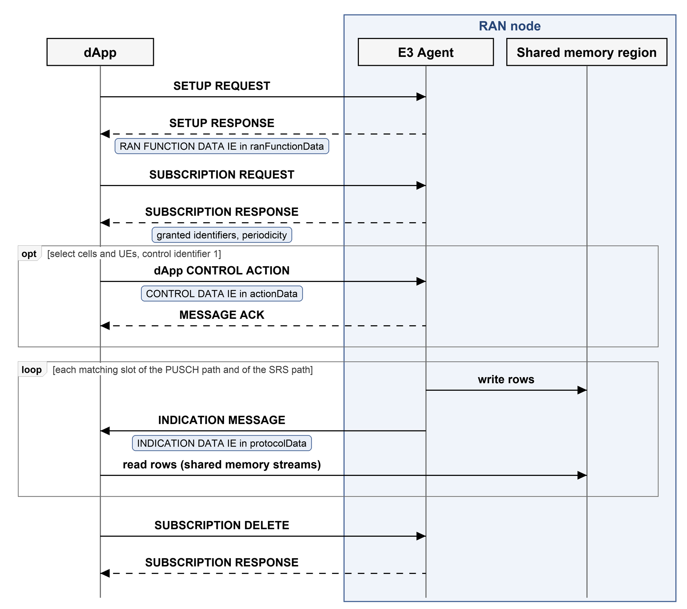

# E3SM services

## General

The present clause describes the E3 services that E3SM-L1-KPM supports. The service
model supports two services:

- the telemetry service, in clause 5.2;
- the control service, in clause 5.3.

The service model supports no other service. Clause 5.4 shows the messages of a typical
use of both services. Clause 4.3 lists the E3AP procedures that carry them.

## Telemetry service

The telemetry service delivers the data of the uplink slots of the cells that the E3
Agent serves. A dApp subscribes with the telemetry identifiers of clause 7.3. For each
slot of an indication path that matches the subscription, the E3 Agent sends one
INDICATION MESSAGE message that carries the values of the granted identifiers.

The telemetry service is the only source of data of the service model. It plays the
role that the REPORT service plays in an E2 service model.

## Control service

The control service lets a dApp narrow its subscription to some cells and some UEs. It
has one control action, Set Subscription Data (clause 7.5). The control service does
not change the behavior of the RAN node.

## Message flow

Figure 5-1 shows the messages of a typical use of the service model. The E3 Agent and
the shared memory region are part of the RAN node (clause 4.2). The figure draws the
dApp outside the RAN node; it may also run inside it. An arrow between the dApp and the
E3 Agent is an E3AP message, and the box under it names the service model payload that
the message carries. An arrow to the shared memory region is a write or a read of the
region, not a message.

The steps are the following.

1. The dApp sends a SETUP REQUEST message. The E3 Agent answers with a SETUP RESPONSE message whose RAN function list holds RAN function `2` and its RAN FUNCTION DATA IE.
2. The dApp sends a SUBSCRIPTION REQUEST message for RAN function `2`. The E3 Agent answers with a SUBSCRIPTION RESPONSE message that lists the granted identifiers.
3. Optionally, the dApp sends a dApp CONTROL ACTION message with control identifier `1` to select cells or UEs. If the dApp set `requestAck` in the message, the E3 Agent answers with a CONTROL RESPONSE message.
4. For each matching slot of each indication path, the E3 Agent writes the rows of the slot to the region, then sends an INDICATION MESSAGE message. The dApp reads the shared memory streams from the region.
5. The dApp sends a SUBSCRIPTION DELETE message, or a RELEASE MESSAGE message.
